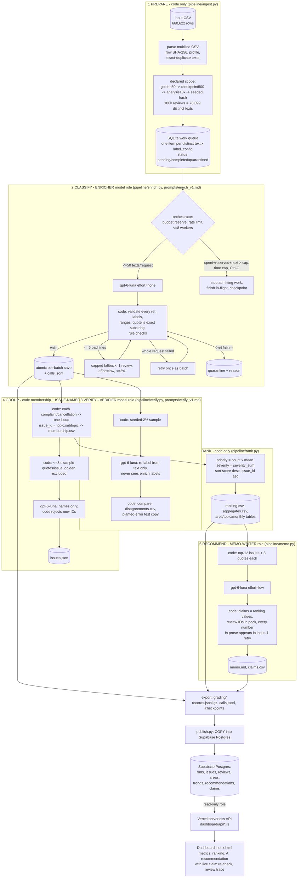

# Architecture

## Who decides what

| Stage | Code decides | Model judges | Why a model call is needed (or not) |
|---|---|---|---|
| 1 Prepare | everything: parsing, hashes, profile, duplicates, scope, queue | - | counting/sorting needs no model |
| 2 Classify | batching, IDs, schema, quote membership, retries, budget, state | topic, subtopic, intent, severity, sentiment, quote span, entities | reading messy, multilingual customer language |
| 3 Verify | sample, comparison, planted-error test | independent re-label | an independent second judgement estimates label error |
| 4 Group | membership (topic.subtopic) - deterministic | short human-readable issue names | naming from examples is a language task; membership is not |
| 5 Rank | all arithmetic | - | arithmetic must be exact and reproducible |
| 6 Recommend | evidence pack, claim/number/ID validation | argument and prose | synthesis; code guards every number |

## Stage contracts

| Stage | Input | Output (saved handoff) | Failure behaviour | Stop condition |
|---|---|---|---|---|
| ingest | CSV path | `state.sqlite` reviews+work, `ingestion_report.json`, `data_manifest.json` | malformed CSV raises; duplicate IDs counted | file read |
| enrich | pending work items | work rows completed/quarantined, `calls.jsonl`, `raw_failed_outputs.jsonl` | transient: backoff x4; invalid: retry once (batch) or capped fallback; then quarantine | queue drained, spend cap, time cap, `--limit`, Ctrl-C |
| verify | completed originals | `verify/verifier_report.json`, `disagreements.csv`, `planted_error_cases.json` | missing lines counted, not retried | sample done or verify cap |
| group | completed complaint/cancellation records | `membership.csv`, `issues.json` | invalid names -> retry once -> code names | one call (cached by input hash) |
| rank | records + membership | `ranking.csv`, `aggregates.csv`, `area_aggregates.csv`, `topic_aggregates.csv`, `monthly_trends.csv`, `sample_only/` | - | deterministic |
| memo | aggregates + evidence pack | `memo.json`, `memo.md`, `claims.csv` | failed checks -> retry once with errors -> saved as failed_validation | validated or 2 attempts |
| export | state + stage files | `grading/` | - | - |
| publish | run folder | Postgres tables | transaction rolls back | - |
